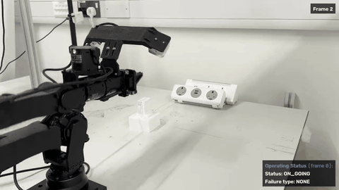
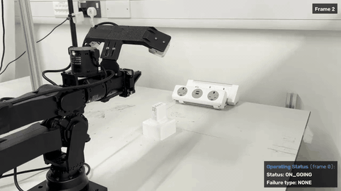

# RoboBrain

RoboBrain monitors plug insertion using separate SUCCESS, DROP and ROTATION specialists, followed by a bounded verification round.

<!-- GitHub removes custom video elements. Linked GIFs keep both demos visible in the README. -->

| Failure case — traj-30: DROP_FAILURE | Success case — traj-31: SUCCESS |
|:---:|:---:|
| [](asset/traj-30-failure.mp4) | [](asset/traj-31-success.mp4) |

Click either animated preview to open the full MP4 video with audio.

## Browser UI

```sh
uv sync
uv run robobrain ui
```

Open **http://127.0.0.1:8765**. The UI runs locally on the computer connected to the cameras. Use `--port PORT` or `--data DIRECTORY` after `ui` to change the port or workspace directory.

The first launch creates **Insert plug**, copying the existing prompt text, reference image bytes, and configuration without modifying the packaged originals. Tasks can be created, renamed, duplicated, deleted, and saved for later runs. Open a task to access Specialists, Prompt Designer, and Monitor.

- **Prompt Designer:** add text, reference-image, and camera/video blocks; edit aliases; enable or reorder blocks; select each block's source and crop. Crops use original-image pixels, with exclusive right/bottom edges. Drag a rectangle or enter coordinates, then Apply and Save. New specialists are empty drafts: paste the existing detector configuration format (`field`, `values`, `failure_type`). No decision roles are inferred. Existing prompts and response mappings are retained.
- **Monitor:** choose Cameras or Video simulation. Enable one or both sources. On macOS use camera indices (`0`, `1`); on Linux use an index or `/dev/video…` / `/dev/v4l/by-id/…`. Check the preview to identify the intended device. Capture width, height and FPS are requests; displayed dimensions are those actually delivered. Allow macOS camera access for the application launching Python.
- **Two views:** each physical camera is opened once and shared by all specialist blocks. Specialists may use either source or both. Insert plug initially keeps its original single-view assignments; enabling another camera does not silently change its model requests. For two-view replay, upload an explicitly paired video into each source. Runs restart videos from the beginning using the existing 30 fps simulator.
- **Run lock:** save before Start. Task switching and configuration mutations are locked from startup through recording finalization, including backend requests from other tabs. Pages remain readable. Stop cancels monitoring and finalizes outputs; it does not control a robot. Refreshing the browser reconnects to the existing run.
- **Continuous monitoring:** UI runs and live-camera CLI runs continue after verified SUCCESS or FAIL, until Stop or an error. A fresh normal observation clears the displayed result to ON_GOING when its confirming specialists are no longer positive (including UNCERTAIN, such as a missing hand). A held event keeps its result without repeated verification; a new or reappearing event is verified normally. Conflicting or insufficient verification evidence yields ON_GOING. Prompts, mappings, vote thresholds and verification sampling are unchanged. The episode watchdog applies only to batch video CLI runs.
- **Record:** off by default and fixed for the run. When checked, save one annotated H.264 MOV at 30 fps, a raw LOG, and a readable JSON under `.robobrain/runs/TASK_ID/RUN_ID/`. Two sources appear side by side at native dimensions, padded to a shared canvas. Video-source audio is retained when present; live cameras supply video only. The UI and its recordings omit the `(frame x)` status heading. Reports retain per-source frame metadata. With Record off, no run artifacts are saved.

Templates and assets are saved in `.robobrain/` (ignored by Git). Back up this directory to keep your templates. Deleting tasks retains shared assets and past recordings. Image uploads accept JPEG/PNG up to 50 MB / 40 megapixels; video uploads accept MOV/MP4/AVI/MKV up to 2 GB.

The UI calls the same monitoring, verification, parsing, thresholds, and decision functions as the CLI. Camera capture uses isolated processes and shared frame buffers for bounded cleanup and reliable reopening on macOS.

## CLI

From this repository:

```sh
uv sync
uv run robobrain --videos video/insert_plug-full_model-aug-28-105trail-1x --record --canvas
```

Or activate the environment created by `uv`:

```sh
source .venv/bin/activate
robobrain --videos video/insert_plug-full_model-aug-28-105trail-1x --record --canvas
```

Specify exactly one of `--videos` or `--camera`; providing both or neither exits with a usage error. Episodes run in numeric order. The default model endpoint is `http://127.0.0.1:9000/v1`, using `/workspace/models/gemma-4-26B-A4B-it`. Keep the vLLM server and its SSH forward running. The recommended server has a 1120-token visual budget.

Recording requires `ffmpeg` on PATH. The live canvas requires a desktop and GUI-enabled OpenCV; omit `--canvas` for headless operation. FFmpeg and a working OpenCV GUI are available on the development machine.

Select another dataset, particular episodes, or a single video:

```sh
uv run robobrain --videos video/insert_plug-no_force-aug-28-1x --record --canvas
uv run robobrain --videos video/insert_plug-full_model-aug-28-105trail-1x --episodes 82 94 --record --canvas
uv run robobrain --videos video/insert_plug-no_force-aug-28-1x/traj-32.MOV --record
```

Live camera CLI examples:

```sh
uv run robobrain --camera 0 --canvas
uv run robobrain --camera 0 --camera 1 --record --canvas
```

`--episodes` is only valid with video input. Camera CLI runs use the existing specialists on the first camera; use the UI to assign different or additional views. Camera recordings are saved below `--output/camera/runs/`.

The `--record` and `--canvas` flags are independent. `--record` saves files, `--canvas` shows the live feed, and omitting both prints each episode's final status. Press **Q**, **Esc**, or close the canvas to stop the run. **Ctrl+C** also stops it. The current episode's logs and a playable recording are finalized; an interrupted recording can be shorter than the full source.

Existing episode output folders are protected. Use `--overwrite` to replace selected recordings, or `--output another-directory` to choose a different output root. `uv run robobrain --help` lists all options.

## Recordings

Each completed recording creates exactly these three files:

```text
output/
  dataset_name/
    traj-x/
      output-traj-x.MOV
      output-traj-x.log
      output-traj-x.json
```

- **MOV:** the full source video at its original resolution, encoded as H.264 at 30 fps, with its audio retained. When a decision arrives after the source ends, the final view continues so the published decision is visible for at least one second. Status changes appear at their actual publication times. Encoding happens after inference for that episode.
- **LOG:** a streaming JSON-lines event log containing every request start, every returned output, errors, cancellations, verification rounds and status updates. Full endpoint response bodies are retained; image payloads are not duplicated into the log.
- **JSON:** an indented report with the final result, configuration, requests sorted by ID, parsed model outputs, raw responses, timestamps and verification events.

The canvas and recording use the same overlay. The current source frame appears in the top-right corner. The bottom-right panel has exactly three lines:

```text
Operating Status (frame x):
Status: ON_GOING | SUCCESS | FAIL
Failure type: NONE | DROP_FAILURE | ROTATION_FAILURE
```

The entire heading is blue; only “Operating Status” is bold. Frame numbers in the overlay and readable JSON are **one-based source-frame numbers**. The heading identifies the most recently completed normal observation or the evidence used for a verified decision. Before the first completed batch it shows frame 0. The raw LOG keeps zero-based source indices. The current source-frame number stays on the last source frame after EOF.

## Monitoring behavior

The camera publishes to its buffer at 30 fps independently of model latency, including after EOF. All three specialists receive separate simultaneous requests. Normal batches run as soon as the preceding batch finishes. Thinking is disabled and temperature is zero.

By default, a positive observation starts one verification round with ten observation timestamps over one second. The next normal batch is reused as observation zero; the original triggering observation is excluded. All three specialists participate, and all **thirty request outcomes** finish before the round resolves. Each specialist needs **more than five positive votes**; conflicting success/failure confirmations or insufficient evidence keep ON_GOING. Normal monitoring continues during verification, and additional rounds cannot overlap or queue up.

Set **evidence horizon** to **0** in Monitor → Model & settings, or set `"evidence_horizon": 0` in a CLI config, to disable verification. Each completed normal batch then determines the status directly: positive success specialists alone give SUCCESS, positive failure specialists alone give FAIL, and conflicting or no positive detections give ON_GOING. No verification requests or rounds are created. Leave the saved duration and thresholds unchanged; they are ignored while verification is disabled. Continuous sessions update on every batch, including returning to ON_GOING when an event disappears. Batch video CLI runs still end on SUCCESS or FAIL. A positive horizon restores the existing verification behavior and requires every threshold to be below that horizon.

SUCCESS requires a seated plug after gripper release. DROP_FAILURE requires positive evidence that the plug rests on the bare table, including beside or behind its stand. FALLING and UNKNOWN observations abstain. ROTATION_FAILURE requires sustained evidence that the plug has rotated or slipped while still held in the gripper during insertion. Batch video CLI decisions remain latched until the next episode; continuous sessions clear and re-arm events as described above. If both failure specialists confirm, the result records both types and displays DROP_FAILURE as the primary type.

All specialists use `Specialist(system_prompt, config)` in `src/robobrain/monitor.py`. Their observation fields, vote mappings, failure types, crops, reference images and thresholds are configured in JSON. The default HTTP connection limit is 36 to accommodate verification and continued normal monitoring.

The batch video CLI episode watchdog defaults to 90 seconds; override it with `--episode-timeout SECONDS`. Continuous UI and camera runs do not use this watchdog. An unresolved episode stays ON_GOING, never an inferred failure. Request errors and cancellations are UNCERTAIN and do not supply positive evidence; five consecutive failed normal batches stop the run with an endpoint error.

Default settings are in `src/robobrain/config.json`. Use this file as the template for `--config custom-config.json`, or use `--base-url URL` to change the endpoint. The native crops are SUCCESS 470 × 400, DROP 1290 × 760, and ROTATION 520 × 540 pixels; application-side model images are never resized or annotated. Dataset annotations are not required and are not used by the production monitor.

Recorded control-action events describe the proposed insertion, release, recovery and reset handoffs. They are marked `SIMULATED`; no real robot or recovery API is connected.

## Checks

```sh
uv run python tests/check_robobrain.py
uv run python tests/check_ui.py
node tests/check_frontend.mjs
```

The optional hardware check opens, reads, releases, and reopens the selected cameras:

```sh
uv run python tests/check_cameras.py --devices 0 1
```

These checks exercise all three specialists, verification thresholds and conflicts, concurrency and rearming, disabled thinking, native image dimensions, malformed responses, cancellation, simulated control handoffs, 30 fps continuation, overlay formatting, complete source preservation, late status timing, audio retention, and raw/readable logs. Recording checks require `ffmpeg` and `ffprobe`.

## Note

Production uses the detector from [experiment 12](test/robobrain-v2-test-12/README.md). Its [three-dataset evaluation](results/rotation-specialist-v12/README.md) achieved **197/198 correct outcomes**: 104/105, 45/45 and 48/48. Dataset 1 traj-93 remains a known false ROTATION_FAILURE caused by gripper occlusion and is included as a system error. Verification rounds reached about 13 seconds on the tested endpoint. The demo videos above were recorded with the earlier success/drop version.
