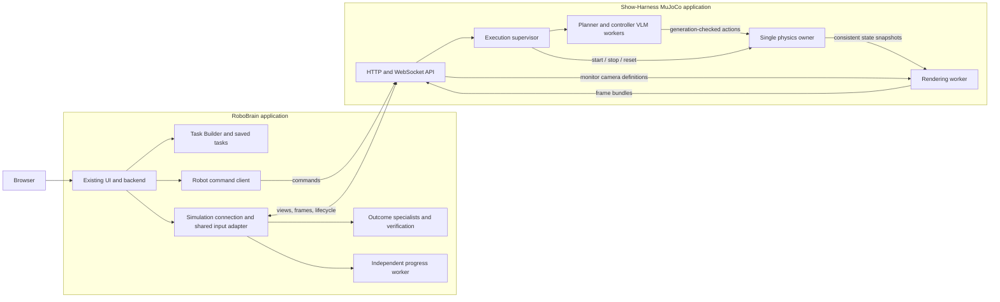

# RoboBrain + Show-Harness MuJoCo integration

Status: implemented architecture with operational details in [the runbook](combined-system-runbook.md) and measured coverage in [validation notes](combined-system-validation.md). The design below records the original proposal; the implementation uses `simulator/` inside this workspace, as required by the later write-scope restriction.

The later [recording contract](combined-system-recording.md) adds per-scene run folders and ends each monitoring session on scene reset, superseding the proposal's allowance for a monitoring run to span episodes. The optional native viewer now runs in a separate process to isolate its graphics context from camera and recording workers.
Date: 2026-09-24

## 1. Purpose and agreed requirements

Combine RoboBrain's visual supervision with the verified Show-Harness MuJoCo manipulation workflow while keeping them independently runnable applications.

The user requirements are:

- Extract only the MuJoCo execution path and its necessary dependencies from Show-Harness.
- Retain RoboBrain's browser UI, task management, Prompt Designer, outcome specialists, independent progress tracking, and AI Task Builder.
- Let RoboBrain request and change simulation camera viewpoints at runtime. Camera access must extend beyond the views predefined for the robot controller.
- Let RoboBrain send `start` and `stop` to the robot executor.
- **Stop robot commands while physics continues.** Stopping must leave camera inspection and monitoring available.
- Agree on the design before implementing runtime changes. This document is the authorized documentation deliverable.

The remaining choices in this document are proposed defaults, not previously approved implementation decisions.

## 2. Inspected baselines

| Application | Repository | Inspected revision |
| --- | --- | --- |
| RoboBrain | `/home/yuxin/workspace/RoboBrain` | `9f80dcf`, version 0.3.4; `dev/0.4.x`, `main`, and local `origin/main` coincide |
| Show-Harness | `/home/yuxin/workspace/Show-Harness` | `8c89d3b`, optional Full HD MuJoCo global recording |

The Show-Harness baseline is the user-verified command:

```bash
python scripts/run_mujoco.py \
  --gui \
  --record \
  --record-global \
  --vlm-backend openai \
  --robot-config configs/robot_mujoco_plug.yaml
```

The earlier RoboBrain assessment described an older checkout. This design supersedes that assessment and uses version 0.3.4. Source inspection establishes the integration points; the combined runtime and its performance have not yet been tested.

### 2.1 RoboBrain today

RoboBrain is a task-configurable monitoring application. Its browser UI runs on `127.0.0.1:8765` by default. Saved tasks combine outcome specialists, prompt/reference/camera blocks, input settings, model settings, and an optional progress definition.

Outcome specialists return visual verdicts and reasons. The default task has SUCCESS, DROP, and ROTATION specialists. A configurable bounded verification round can confirm outcomes; an evidence horizon of zero disables that round. Continuous UI monitoring can clear and re-arm events as visual evidence changes.

Progress uses a separate worker and returns `reason` plus a configured `node_id` or `UNKNOWN`. It handles confirmation, freshness, and optional counts. Nodes can be skipped or revisited. Progress never supplies SUCCESS/FAIL votes, and its final node does not terminate a task.

Task Builder generates editable prompts/configurations for outcome specialists and, when requested, progress nodes and criteria. It uses independently configured authoring-model settings. It does not train models.

Current inputs support local cameras or uploaded videos and at most two sources. The UI's Stop ends monitoring and recording. `ReplayController` logs simulated robot handoffs; it does not call a robot API.

### 2.2 Show-Harness today

The verified execution path is:

```text
Plug task/configuration
  -> subgoal planner and controller VLM
  -> one Cartesian/gripper action
  -> MuJoCo physics
  -> fresh camera/proprioceptive observations
  -> next decision
```

The plug task uses the Panda model, plug/socket/stand scene, four RGB controller views, and wrist depth represented as text. `--record` writes local synchronized camera videos and annotations. `--record-global` adds the fixed `lab_overview` recording; neither is a network camera service.

Physics currently advances inside action execution and pauses during VLM waits. The existing `STOP` token is a one-step hold, not a persistent execution stop. Episode completion closes the current runner's recording resources, and the CLI closes the simulation session on exit.

## 3. Architecture and ownership

Use two independently installable applications with separate environments, VLM clients, configuration, logs, and process lifetimes. RoboBrain communicates with the simulation through a versioned network contract; it does not import Show-Harness Python modules or own MuJoCo state.



| Responsibility | Owner |
| --- | --- |
| Task authoring, prompts, references, source assignments | RoboBrain |
| Visual outcome and progress decisions | RoboBrain |
| Robot planning, action execution, physics, scene reset | Show-Harness MuJoCo |
| Rendering requested virtual cameras | Show-Harness MuJoCo |
| Operator controls and optional outcome-to-stop policy | RoboBrain; commands applied by Show-Harness |
| Simulator success diagnostics | Show-Harness evaluation/logging |

Keep simulator ground-truth success flags and object poses out of RoboBrain's visual decision inputs. Execution status is displayed separately from visual outcome and progress. Diagnostic ground truth can be compared with visual results offline.

Proposed local addresses:

| Service | Default address |
| --- | --- |
| RoboBrain UI/backend | `http://127.0.0.1:8765` |
| Show-Harness MuJoCo API | `http://127.0.0.1:8766` |
| Each VLM backend | Its own existing configuration |

Initial deployment is on one host with loopback binding. Remote deployment is a later extension. Ports remain configurable. The browser talks to RoboBrain's backend, which owns the simulation connection, so refreshing a page does not create another simulator or control session.

## 4. MuJoCo-only extraction

Produce an independent `show-harness-mujoco` project, preferably in a sibling checkout such as `/home/yuxin/workspace/Show-Harness-MuJoCo`. That path is proposed; creating it is not part of this document change. RoboBrain contains only its adapter and UI integration.

| Retain/adapt | Reason |
| --- | --- |
| MuJoCo session, depth, socket-geometry, success helpers | Verified physics and observation implementation |
| Cartesian action definitions, MuJoCo controller, required base controller logic | Same action semantics, IK, limits, and gripper behavior |
| Shared episode logic, planner/controller clients, required plugins | Preserve VLM-driven task execution |
| Plug/base configuration and referenced primitive configuration | Preserve the verified configuration closure |
| Prompts and relevant prompt-building/history utilities | Preserve the VLM observation/action contract |
| Scene MJCF, lab assets, pinned Panda model and meshes | Reproducible scene construction |
| Episode logging, recording, smoke/replay utilities and applicable tests | Validation and standalone use |

Exclude physical-robot drivers, ROS/hardware camera interfaces, unrelated simulators, training/fine-tuning, and unrelated teleoperation applications. Retain required upstream licenses and asset attribution.

`core/sim/` alone is not a standalone package. The current launcher and runner import shared modules that reach physical-robot dependencies. Extract generic runner wiring and session/controller interfaces before removing those imports. Inventory prompt/config imports and transitive assets as part of this step.

Preserve a standalone CLI equivalent to the verified command. Add a service entry point using the same scene, controller, and planning components. The service starts with a ready scene and waits for an explicit robot start; it must not begin task execution merely because a client requests an image.

## 5. Execution lifecycle and continuous physics

### 5.1 Separate states

Track three independent state domains:

- Simulation service: `INITIALIZING`, `READY`, `RESETTING`, `ERROR`, `CLOSED`.
- Robot executor: `IDLE`, `RUNNING`, `STOPPING`, `STOPPED`, `FINISHED`, `ERROR`.
- RoboBrain monitoring: its existing starting/running/stopping/finalizing lifecycle.

Physics continues while the service is ready, including when robot execution is idle, stopped, or finished. Reset and unrecoverable physics errors are explicit exceptions. A planner/API failure stops execution into a hold if physics remains healthy; it does not require destroying the scene.

### 5.2 Command semantics

| Command | Required behavior |
| --- | --- |
| Start robot from IDLE | Create an attempt, observe the current scene, and begin task execution |
| Start robot from STOPPED | Resume the same attempt using fresh observations and revalidated/replanned actions |
| Stop robot | Cancel queued/active task motion, block new task actions, hold the arm, retain the gripper command, and keep physics/rendering/monitoring running |
| Reset scene | While IDLE/STOPPED/FINISHED, or executor ERROR after hold is applied and physics is healthy, recreate the configured initial scene, settle it, publish a new episode identity, and return to IDLE without starting the robot |
| Stop monitoring | Stop RoboBrain inference and finalize its recording; do not issue a robot command |
| Shutdown simulation | Explicit service termination; independent of robot stop and monitor stop |

Holding means cancelling the active trajectory and setting the arm's hold target from its measured joint state at the applied stop. Preserve the gripper actuator control value sampled at that boundary, including if opening/closing was mid-ramp; cancel the remaining ramp rather than completing it. Do not release a held object automatically. The arm remains actuated; gravity, contact, momentum, and object motion continue. Do not teleport joint positions or zero velocities. Stop is not a physical guarantee of zero instantaneous velocity.

Start while RUNNING is idempotent and does not launch another worker. Stop while STOPPED is idempotent. Stop from IDLE is a no-op that remains IDLE with no attempt; stop from FINISHED remains FINISHED. Stop from executor ERROR ensures hold but preserves the error state. Starting a FINISHED or ERROR attempt requires reset; direct resume from ERROR is not supported. Reset while RUNNING/STOPPING is rejected; the client first stops and waits for its applied acknowledgement. Reset from executor ERROR is allowed only when the service reports healthy physics and an applied hold. An unrecoverable simulation error requires explicit service restart.

**Resume must not invoke the existing runner startup sequence unchanged.** That sequence issues an initial gripper release. Separate first-attempt initialization from resume so a stopped grasp is preserved. Record interrupted actions as partial with their measured effect; do not silently complete the old trajectory after resume.

### 5.3 One physics owner

Only one worker owns mutable live `MjData`, applies actuator targets, and calls `mj_step`. Controllers submit cancellable targets and await completion events. They no longer advance physics inside `_advance()` in service mode. Planner, controller, recovery, network, rendering, and encoding work cannot block this physics worker.

Move interpolation, gravity compensation, action duration, settling, and completion bookkeeping into the physics-owned scheduler. Measure action durations in simulation time and preserve model timestep and measured-motion checks. Pace service mode against monotonic wall time and report achieved real-time factor; do not silently enlarge the physics timestep when rendering falls behind. Bound catch-up work so overload cannot indefinitely starve command processing.

This changes the existing behavior: objects can move or slip during VLM waits. Preserve the existing decision-synchronous mode for standalone baseline regression, and make continuous physics an explicit service mode. The verified controller must be revalidated under it. Do not run an extra stepping thread beside the old `_advance()` loop.

### 5.4 Cancellation and acknowledgements

Maintain an `execution_generation`. Applied start, stop, reset, and invalidating execution transitions advance it; idempotent retries and state-preserving no-ops do not. Every asynchronous planner/controller/recovery result carries the generation and attempt it was issued under. The supervisor rejects results from an earlier generation before they can dispatch an action. The physics owner checks attempt/generation again when applying a target, atomically with processing stop/reset; this closes the race with work already dispatched before a stop. A provider request may finish remotely after cancellation; its response must have no execution effect.

Bound outstanding and abandoned VLM requests with concurrency limits and timeouts; repeated stop/start must not accumulate unlimited provider calls. In continuous mode, also record the age of the observation used for a normal action. Before dispatch, validate that the action remains applicable to the current measured state and stage. Tune any age/re-observation policy using actual controller latency; an unrealistically short fixed expiry can otherwise prevent every VLM action from executing.

On acceptance, the supervisor enters STOPPING and blocks new action dispatch. The physics worker checks stop at tick boundaries. HTTP receipt returns `accepted`; a later acknowledgement reports `applied` after motion cancellation and hold installation. The UI displays STOPPING until then. Stop handling must not wait for a VLM response, image encoding, video finalization, or the normal action queue.

Application lifetime is separate from episode lifetime. Finishing an attempt finalizes its controller/logging state while leaving the scene and camera service available. GUI/renderer ownership must follow the chosen MuJoCo platform's thread requirements.

## 6. Dynamic camera service

### 6.1 Views created at runtime

RoboBrain creates monitor views with a world-space target, distance, azimuth, elevation, resolution, and requested frame rate. It can change their poses during execution, after robot stop, and during controller VLM waits. They do not require predefined XML cameras and do not modify the robot controller's cameras or the GUI viewer camera.

MuJoCo's free camera supports target/distance/azimuth/elevation without being part of the physical model. It has no roll. A future full-pose camera can use the lower-level camera interface; the initial contract need not promise roll or arbitrary intrinsics. See the [official camera documentation](https://mujoco.readthedocs.io/en/stable/programming/visualization.html#cameras).

Example proposed view definition:

```json
{
  "view_id": "inspection",
  "camera": {
    "type": "free",
    "lookat_m": [0.45, 0.0, 0.15],
    "distance_m": 0.8,
    "azimuth_deg": 45.0,
    "elevation_deg": -25.0
  },
  "width": 640,
  "height": 480,
  "requested_fps": 15
}
```

These values illustrate the schema; they are not validated plug-scene presets. Use MuJoCo world coordinates in metres and its azimuth/elevation convention in degrees. Return the effective parameters and projection metadata with the frames. Fixed named cameras may be offered as optional presets, but runtime free cameras are the required feature.

The first release supports two simultaneously active monitor views, matching RoboBrain's existing task/source limit. Both can be repositioned arbitrarily within validated numeric/resource bounds. More views, depth streams, camera roll, and autonomous VLM view-selection policy are later extensions. The API must allow a RoboBrain client to request poses; automatic selection of the best pose is a separate capability.

### 6.2 Rendering and synchronization

The physics owner publishes consistent snapshots at a bounded cadence. A rendering worker owns its renderer/OpenGL context and a private data copy. It renders all requested views from one snapshot and publishes them as an atomic bundle. It does not read or update live `MjData` concurrently with stepping.

MuJoCo rendering requires the proper context on the rendering thread. Its supported parallel simulation pattern uses separate data objects with a shared read-only model. Keep renderer settings immutable during use or owned by the rendering side. See [Python rendering](https://mujoco.readthedocs.io/en/stable/python.html#rendering) and [MuJoCo threading](https://mujoco.readthedocs.io/en/stable/programming/simulation.html#multi-threading).

The current `_prepare_render()` refreshes live kinematics/camera transforms, and global-recorder initialization temporarily changes model framebuffer settings. These paths must be adapted before introducing concurrency. Allocate required framebuffer sizes before worker startup, or isolate rendering model/context configuration. Keep network encoding and disk writing outside the physics lock.

The robot controller also needs coherent observations: its RGB views, wrist depth, proprioception, camera axes, and calibration must derive from one identified snapshot. That consistency is implicit in the current synchronous loop and would be lost by reading each component from independently advancing live state. Prioritize controller observation requests over replaceable monitor previews without allowing rendering to block physics.

Snapshot polling and live streaming are both supported. Video pixels alone cannot reconstruct arbitrary new viewpoints; the server performs the requested 3D rendering. No model/asset replication is required in RoboBrain.

### 6.3 Pose changes during a monitoring run

Persisted task definitions, prompts, crops, source assignments, and recording dimensions remain locked during a run. Camera pose updates are a narrowly defined runtime operation, stored separately from that immutable task snapshot. Saving a changed pose as a task preset happens after the run.

Each pose change increments that view's `camera_revision`. The frame bundle identifies the revisions actually used, so the UI can distinguish a requested pose from an applied pose. On a revision change:

- Cancel/discard in-flight normal/direct outcome results and pending verification involving the changed view.
- Clear affected progress confirmation candidates and motion history.
- Treat the prior displayed result as historical until fresh evidence is available; it cannot trigger an automatic command.
- Begin inference from frames carrying the new revision.

Keep stream dimensions fixed for the run so recorder canvases and pixel crop validation remain valid. Use full-frame inputs initially for movable cameras; explicitly configured crops remain pixel regions, not object-following regions. Changing a viewpoint can invalidate reference suitability even when a crop is numerically valid.

## 7. Network contract

Use versioned JSON HTTP endpoints for configuration/control and a WebSocket for frame bundles. Lifecycle events use a separate event stream so frame backpressure cannot bury command acknowledgements. Snapshot requests support debugging and reference capture without subscribing to video.

### 7.1 Proposed simulator endpoints

| Endpoint | Contract |
| --- | --- |
| `GET /v1/health` | Service identity, protocol version, readiness, and clock-handshake timestamps |
| `GET /v1/status` | Authoritative scene/execution state, identities, generation, and last applied command |
| `POST /v1/control-session` | Claim exclusive execution control; return a service-scoped token and lease expiry |
| `POST /v1/control-session/renew` | Renew the current controller lease |
| `DELETE /v1/control-session` | Release execution ownership without changing robot state |
| `POST /v1/commands` | Submit `start`, `stop`, or `reset`; return a command ID and acceptance/rejection |
| `GET /v1/commands/{command_id}` | Retrieve accepted/applied/failed result after retries or reconnect |
| `GET /v1/views` | Current monitor views and effective revisions |
| `POST /v1/views` | Create a runtime monitor view |
| `PATCH /v1/views/{view_id}` | Update camera pose with expected camera revision |
| `DELETE /v1/views/{view_id}` | Remove an unused view; active task sources must first be detached |
| `POST /v1/snapshots` | Request an identified bundle for selected views; JPEG or lossless PNG |
| `WS /v1/frames` | Subscribe to atomic latest-frame bundles for selected views |
| `GET /v1/events` | Server-sent lifecycle/command events with sequence IDs |

RoboBrain adds backend routes that proxy these operations through its simulation client. Ordinary saved-task mutation locks remain in force. Robot control and camera-pose updates receive explicit operational routes rather than bypassing all run locks.

Commands carry `request_id`, expected `server_instance_id`, `episode_id`, and, when applicable, `attempt_id` and `execution_generation`. Reusing a request ID with the same body returns the same result; using it with a different body is rejected. An obsolete identity/generation is rejected rather than applied to a new attempt. After a conflict, the client reads status and may issue a fresh command deliberately. A pending stop prevents start until its application completes.

Example stop request:

```json
{
  "request_id": "operator-stop-001",
  "command": "stop",
  "server_instance_id": "sim-instance-a",
  "episode_id": "episode-004",
  "attempt_id": "attempt-004",
  "execution_generation": 7,
  "reason": "operator"
}
```

The first release has one execution controller (RoboBrain or a standalone client) per service. The server issues a control-session token through an exclusive claim endpoint; command requests carry it and the client renews a lease. A second live claim is rejected. After explicit release or lease expiry, a client can deliberately claim control and reconcile current status. Lease expiry or a new claim does not stop, resume, reset, or invalidate the independently running robot task; it only changes who may submit new commands. Requests with an expired or previous owner's token are rejected. A service restart invalidates all tokens. Multiple browser tabs use RoboBrain's existing shared runtime. Read-only inspection does not acquire execution ownership. Ownership and command validation must be enforced at the API, not only by disabled UI buttons.

Monitor views have separate server-issued ownership tokens, allowing read-only observers to manage their own cameras without execution control. Create/update/delete operations validate the expected service instance; PATCH/DELETE additionally validate view ownership and expected camera revision. Reconnection cannot mutate another client's view or a recreated view using a stale identifier/token. These checks do not grant access to the controller's fixed cameras.

### 7.2 Frame and identity contract

| Field | Meaning |
| --- | --- |
| `server_instance_id` | Changes whenever the service restarts |
| `episode_id` | Changes on scene initialization/reset |
| `attempt_id` | Allocated on first start; retained across stop/resume; null before first start |
| `execution_generation` | Invalidates execution results across control transitions |
| `bundle_id` | Identifies one published multi-view bundle |
| `state_seq` | Identifies the physics snapshot used for every view in the bundle |
| `sim_time_s` | Simulation time, independent of transport and inference latency |
| `captured_at_server_monotonic_ns` | Snapshot capture time on the service clock |
| `sent_at_server_monotonic_ns` | Send time on that same clock |
| Per-view `view_id`, `camera_revision`, camera parameters, width, height, encoding | Image identity and interpretation |

Frames are RGB at the rendering boundary; the adapter explicitly converts to OpenCV BGR. Images given to the VLM contain no UI overlays or ground-truth annotations. Encode JPEG at a configurable quality for live monitoring, and allow PNG for saved references.

One WebSocket binary message contains a four-byte big-endian JSON-header length, the UTF-8 header, then concatenated encoded image payloads. The header gives each image's offset and length relative to the payload region. The receiver validates lengths/dimensions and publishes a bundle only when all subscribed views are present and valid. This avoids matching independent metadata and image messages by arrival order.

Use a bounded latest-bundle buffer; replace an unsent/unused bundle instead of queueing a video backlog. Lifecycle events are ordered and retrievable independently. On an event-history gap, reread `/v1/status` before enabling controls. Reconnection never implicitly resumes the robot.

### 7.3 Time, freshness, and duplicates

Do not infer simulation time from frame count or nominal FPS. Keep RoboBrain's existing 30 fps presentation timeline for video output, but retain native bundle/state IDs and both simulation and capture times for evidence.

Attach client receive time locally. Estimate server/client clock offset and uncertainty through periodic request/response clock handshakes; do not subtract unrelated monotonic clocks directly. Use a conservative capture-age estimate for freshness. If the bound is unknown or exceeds the configured limit, show unavailable/stale evidence and prohibit automatic control from it. UTC timestamps are useful for log correlation, not monotonic age checks.

Repeated delivery or repeated reads of the same state/view identity do not create new evidence. A physically stationary scene sampled at a later physics tick is a fresh observation. Outcome verification and progress confirmation must require fresh snapshot identities; missing/duplicate samples abstain and cannot increase positive counts. Represent missing/duplicate verification samples as explicit UNCERTAIN/abstention entries, preserving the complete configured (slot, specialist) set required by the decision function. Do not silently shorten the round or lower its thresholds. A verification round remains bounded by its configured observation window rather than waiting indefinitely for missing frames.

All views used together come from one `state_seq`. A simulation connection returns a complete bundle to `Inputs`; sequential calls to unrelated per-view readers must not mix snapshots. On service restart/reset, clear buffered frames and pending inference, reset evidence state, and record the new episode boundary. Local monitoring run IDs may span multiple explicitly identified episodes.

## 8. RoboBrain UI and task integration

### 8.1 Input adapter

Add `mujoco` alongside `camera` and `video` input modes. A task stores a simulation connection URL and stable logical sources such as `camera1` and `camera2`, each mapped to a monitor view definition. A shared `SimulationConnection` owns transport, reconnection, identity validation, and the latest atomic bundle. A MuJoCo input adapter exposes those frames to preview, outcome, progress, and recording consumers. The command/status connection is owned outside the inference run and survives reader teardown, so stopping monitoring cannot remove robot controls.

Keep logical task source IDs distinct from server runtime view IDs. Reconnecting can recreate runtime views from saved presets without rewriting specialist blocks. Extend task validation, Task Builder inputs, source connection routes, and UI serialization together. Preserve existing camera/video defaults and load old saved tasks without an automatic destructive migration.

### 8.2 Monitor page

The Monitor page presents:

- Simulation connection and scene/execution status.
- Two configurable virtual-camera previews with orbit/target/distance controls and saved presets.
- Existing specialist verdicts and evidence verification.
- Existing independent progress display, evidence age, and transition history.
- **Start monitoring / Stop monitoring** and separate **Start robot / Stop robot** controls.
- Reset scene, available when IDLE, STOPPED, FINISHED, or in a recoverable executor ERROR after hold is applied.

Starting robot execution does not silently start or stop monitoring. The normal supervised workflow starts monitoring first and then starts the robot. Users can also run Show-Harness independently. The UI keeps robot controls usable when the inference worker is stopped or fails.

On robot stop, maintain the camera connection and both monitoring paths. This allows RoboBrain to observe whether a held object subsequently slips or settles. Do not equate STOPPED with task FAIL or SUCCESS.

### 8.3 Task Builder and Prompt Designer

Reuse Create with AI for the simulated task:

1. Connect to the simulation and configure monitor viewpoints.
2. Capture still images into RoboBrain's existing asset store, with view/episode provenance.
3. Describe the task and desired failure conditions; request progress generation if wanted.
4. Generate and review outcome specialists, progress criteria, references, and source assignments.
5. Save the task and inspect the exact model requests before starting monitoring.

Reference images are explicit saved examples, never an automatically changing live feed. A source block uses current images; an image block uses a saved asset. Builder-generated outputs remain drafts and use the current validation/repair workflow. The builder stays locked during monitoring; camera-pose control is not permission to edit prompts mid-run.

Preserve the separate progress configuration rather than converting progress nodes into success/failure specialists. Initial scope retains the existing requirement for at least one outcome specialist alongside optional progress.

### 8.4 Example plug task

Create a separate MuJoCo plug task template. The current white USB-adapter/power-strip prompts and real-video references are not automatically suitable for the orange handle, silver cylindrical pin, blue socket, and gray stand.

Candidate observable progress nodes include `ON_STAND`, `GRASPED`, `LIFTED_CLEAR`, `ALIGNED_ABOVE_SOCKET`, `INSERTING`, `SEATED_HELD`, `RELEASED`, and `RETREATED`. Draft mutually distinguishable criteria and use UNKNOWN when occlusion prevents classification. These labels are proposals, not validated detectors. Do not assign a percentage from node order; leave count metadata empty for this manipulation sequence.

Outcome success must match the chosen complete task: seated insertion, released/open gripper, and sufficient retreat. Show-Harness currently requires TCP clearance greater than 50 mm above the plug top by default; a visual monitor must use an inspectable view and appropriate scale/calibration, or abstain. Simulator position/success flags must not be substituted for visual evidence.

The newer RoboBrain success prompt already requires release; the remaining semantic gap includes retreat and simulation-specific geometry. Define slip/tilt failures for this task rather than inheriting assumptions about a keyed plug: Show-Harness's circular pin/bore does not require keyed yaw alignment.

## 9. Outcome-driven commands

Manual start/stop is required. Automatic stopping is an optional task policy, disabled by default during initial validation. Proposed selectable policies are observe only, stop on confirmed FAIL, or stop on confirmed SUCCESS/FAIL. Progress alone never triggers robot completion or stop.

A policy acts on a fresh decision event belonging to the current service, episode, attempt, execution generation, and relevant camera revisions. With verification enabled, use its resolved outcome; with verification explicitly disabled, use the completed direct decision. Show the selected policy and evidence mode in the UI.

Generate one idempotent stop per eligible outcome event. A later return to ON_GOING does not restart the robot. Resume is explicit and creates a new inference/control boundary. Invalidate old pending decisions across resume so they cannot immediately stop the resumed attempt.

Replace the applicable `ReplayController` handoffs with a real command adapter; do not execute all its currently logged actions. Its simulated RELEASE_GRIPPER, recovery, and RESET_SCENE actions are outside the agreed start/stop requirement. Robot stop must preserve the gripper unless separately commanded.

## 10. Recording, disconnects, and performance

RoboBrain retains annotated recordings, raw events, readable reports, and progress overlays. Record command acceptance/application, camera revisions, frame identities, freshness, execution state, and explicit episode boundaries. Keep a stable output canvas during a run.

Show-Harness retains controller observation/action logs and optional original camera/global recordings. In continuous service mode, record actual elapsed simulation activity; the old recorder's synthetic decision-hold frames must not substitute for VLM wait periods. Label timing mode in metadata. Log applied action times, interrupted trajectories, control holds, and idle/VLM-wait intervals in simulation time: action tokens alone no longer reproduce the physics trajectory during replay. Robot stop does not itself close the service recording; episode reset/completion finalizes the appropriate episode segment according to its recording setting. RoboBrain recording continues independently.

Route the new MuJoCo input mode through RoboBrain's live-recording path explicitly; the current runtime enables that path only for local camera mode. Use bounded encoder queues and report recording gaps/overload rather than blocking physics or pretending every frame was captured.

| Condition | Proposed behavior |
| --- | --- |
| Browser refresh | Reconnect to RoboBrain's existing runtime |
| RoboBrain monitoring stops/errors | Show-Harness keeps its current execution state; robot controls remain separate |
| Frame stream becomes stale/disconnected | Mark evidence unavailable; suppress automatic commands from old evidence; reconnect without auto-start |
| Simulator restarts | Require status/identity reconciliation and recreate monitor views; never reuse old execution requests |
| Controller VLM fails | Stop new task actions, hold the robot, report executor error; continue healthy physics/rendering |
| Command acknowledgement is lost | Query/retry the same command ID; do not assume success or issue duplicate work |
| Renderer overload | Drop intermediate monitor bundles and report delivered rate; never accumulate an unbounded backlog |
| Physics cannot keep wall time | Report actual simulation rate and latency; preserve the model timestep |

The proposed disconnect default is to let the independently running simulator continue, with supervision shown as unavailable. A future explicit stop-on-supervisor-disconnect policy can be added; it must not be an accidental effect of closing a browser or camera stream.

Initial tuning target: two 640×480 monitor views at a requested 15 fps, separately configurable from recording and model sampling. This is a starting budget, not a measured guarantee. Measure capture-to-publication, receive-to-decision, command acceptance-to-application, dropped bundles, and real-time factor. Set a stop-latency acceptance budget after measuring the target machine; it must be independent of VLM latency. Rendering FPS is not VLM decision frequency or a hard real-time guarantee.

## 11. Implementation map

| Area | Existing code to adapt |
| --- | --- |
| Source schemas and saved tasks | RoboBrain `src/robobrain/workspace.py` |
| Atomic simulation input adapter | RoboBrain `src/robobrain/sources.py`; proposed connection/client module |
| Shared outcome/progress input lifecycle | RoboBrain `src/robobrain/runtime.py` |
| Evidence identity/freshness and command events | RoboBrain `src/robobrain/monitor.py`, `progress.py` |
| Camera/control routes and run-lock exceptions | RoboBrain `src/robobrain/web.py` |
| Input selection, camera controls, robot buttons | RoboBrain `src/robobrain/static/app.js`, `style.css` |
| Generation input/schema support | RoboBrain `src/robobrain/task_builder.py`, `prompts/task_builder.md` |
| Reports and overlays | RoboBrain `src/robobrain/presentation.py` |
| Standalone/service assembly | Extracted Show-Harness `scripts/run_mujoco.py`, required shared launch wiring |
| Physics ownership and target scheduler | Extracted `core/sim/mujoco_session.py`, atomic controller |
| Persistent execution lifecycle | Extracted shared runner and planner/controller/recovery boundaries |
| Independent render/record workers | Extracted session rendering and `core/record/mujoco_recorder.py` |

## 12. Delivery sequence and acceptance

| Phase | Deliverable | Acceptance evidence |
| --- | --- | --- |
| 1. Extract baseline | Standalone MuJoCo-only project and dependency/asset manifest | Smoke/action/depth/scene/recording checks pass without physical-robot packages; original CLI behavior reproduced in baseline mode |
| 2. Execution service | Single physics owner, persistent service, start/stop/reset | Stop during planning, motion, gripper action, and recovery; physics time continues; held object is not intentionally released; stale results cannot execute |
| 3. Camera API | Runtime free views, snapshots, atomic streaming | Change views without XML edits or controller-camera changes; same snapshot for paired views; bounded buffers; responsive during VLM waits and robot stop |
| 4. RoboBrain integration | MuJoCo inputs, previews, separate controls, identity handling | Existing camera/video tasks still work; outcome and progress share coherent bundles; reset/reconnect/camera-change invalidation works |
| 5. Authoring and recording | Builder inputs, reference capture, simulation task template, correlated logs | Generated status/progress configurations preview correctly; source assignments persist; recordings retain camera/control/episode provenance |
| 6. End-to-end validation | Manually supervised run, then optional automatic stop | Known success/failure cases agree with reviewed visual criteria; continuous-physics behavior assessed against baseline; measured latency/throughput reported |

Use existing relevant checks as regression coverage and add focused tests for the new boundaries. Required scenarios include duplicate start/stop requests; lost acknowledgements; concurrent UI commands; late planner/controller replies after stop/reset; resume without startup release; reset during a verification round; repeated frame delivery; incomplete bundles; camera changes during inference; stream loss; and final progress without visual success.

Validate controller behavior under continuous physics before enabling automatic intervention. Visual evaluation should include successful insertion plus retreat, seated-but-held, released-but-insufficient-retreat, stand/occlusion cases, and visible drop/slip cases. Preserve outcome/progress independence and uncertainty handling. Performance claims require measurements with the requested recording flags and both monitor views active.

Completion means both applications remain independently launchable; RoboBrain retains its existing authoring/UI workflows; arbitrary runtime monitor viewpoints work; robot stop leaves physics and monitoring running; and no result from an obsolete scene/control/camera context can affect the current attempt.

## 13. Decisions proposed for agreement

| Decision | Proposed default |
| --- | --- |
| Extraction location | Separate sibling `Show-Harness-MuJoCo` project |
| Service transport | HTTP commands/snapshots, WebSocket frame bundles, SSE lifecycle events |
| Service address | Loopback port 8766; RoboBrain keeps 8765 |
| Physics timing | Continuous wall-clock-paced service mode; retain standalone baseline mode |
| Stop behavior | Cancel motion, hold measured arm state, preserve gripper command, continue physics |
| Resume behavior | Fresh observation/replanning within the same attempt, no startup release |
| Initial camera scope | Two runtime free cameras; pose changes permitted during runs; resolution fixed |
| Automatic intervention | Disabled initially; explicit outcome-based policy later |
| Supervision disconnect | Simulator continues independently; no automatic resume on reconnect |
| Task completion | Simulation-specific seating, release, and retreat criteria; progress remains separate |

## 14. Source references

Paths below refer to the inspected revisions in section 2. They are evidence for current behavior, not claims that proposed endpoints/classes already exist.

- [RoboBrain README](../README.md): UI, Task Builder, continuous outcomes, progress, recording.
- [Task schemas](../src/robobrain/workspace.py), [Task Builder](../src/robobrain/task_builder.py), [builder prompt](../src/robobrain/prompts/task_builder.md).
- [Input handling](../src/robobrain/sources.py), [runtime](../src/robobrain/runtime.py), [web API](../src/robobrain/web.py).
- [Outcome monitor and simulated handoffs](../src/robobrain/monitor.py), [progress worker](../src/robobrain/progress.py), [success prompt](../src/robobrain/prompts/success.md).
- [Show-Harness launcher](../../Show-Harness/scripts/run_mujoco.py), [plug configuration](../../Show-Harness/configs/robot_mujoco_plug.yaml), [base configuration](../../Show-Harness/configs/robot_mujoco.yaml).
- [MuJoCo session](../../Show-Harness/core/sim/mujoco_session.py), [atomic controller](../../Show-Harness/interpreters/mujoco_atomic_controller.py), [shared runner](../../Show-Harness/core/runners/real.py), [recorder](../../Show-Harness/core/record/mujoco_recorder.py).

The Show-Harness relative links assume the current sibling workspace layout. Official MuJoCo references are linked beside the API/concurrency claims they support.
